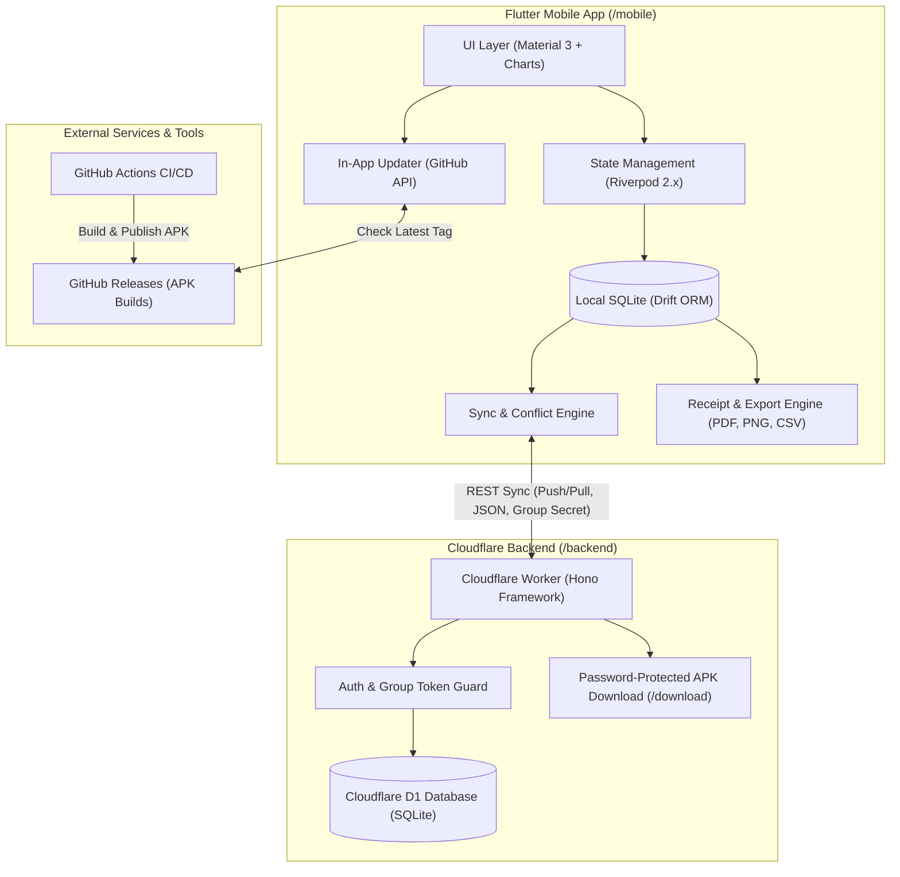
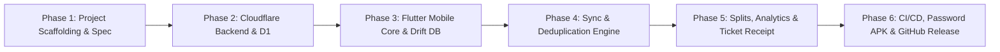

# SplitCount — Technical Specification & Architecture Design

> **Project Overview:** A private, lightweight, local-first mobile expense-splitting application (Flutter) with a serverless Cloudflare Workers + D1 SQLite backend. Designed for personal and private group use (without Google Play Store dependencies), featuring offline operation, smart duplicate detection, itemized vintage receipt ticket generation, CSV exports, multi-payer expense splits, and automated GitHub-driven APK updates.

**Live Backend Deployment:**
- **Worker Base URL:** `https://splitcount-backend.saularenasramirez.workers.dev`
- **Cloudflare D1 Database ID:** `9645a3c4-0d04-49eb-8fd5-0b518a33f02a`
- **Protected APK Download URL:** `https://splitcount-backend.saularenasramirez.workers.dev/download`

---

## 1. System Architecture & High-Level Flow



---

## 2. Directory Structure

```
splitCount/
├── spec.md                     # Comprehensive technical specification & implementation guide
├── backend/                    # Cloudflare Worker & D1 Schemas
│   ├── wrangler.toml           # Cloudflare Wrangler configuration (D1 binding, env vars)
│   ├── package.json            # Node.js dependencies (Hono, Zod, Wrangler)
│   ├── tsconfig.json           # TypeScript configuration
│   ├── migrations/             # Versioned Cloudflare D1 SQL migrations
│   │   ├── 0001_initial_schema.sql
│   │   └── ...
│   └── src/
│       ├── index.ts            # Worker entrypoint and route mounting
│       ├── middleware/
│       │   └── auth.ts         # Master password & Group invite token verification
│       ├── routes/
│       │   ├── sync.ts         # Push & Pull incremental sync endpoints
│       │   ├── groups.ts       # Group creation & invite validation
│       │   ├── download.ts     # Password-protected APK download page & streaming
│       │   └── version.ts      # App version proxy endpoint
│       └── utils/
│           ├── db.ts           # D1 typed query helpers
│           └── crypto.ts       # Group token verification and hashing
│
├── mobile/                     # Flutter Android Application
│   ├── pubspec.yaml            # Flutter dependencies (Drift, Riverpod, fl_chart, etc.)
│   ├── analysis_options.yaml   # Dart linter configurations
│   ├── android/                # Native Android configuration (APK signing, permissions)
│   └── lib/
│       ├── main.dart           # App entrypoint & initializations
│       ├── core/
│       │   ├── constants/      # App colors, styles, default categories
│       │   ├── network/        # HTTP client (Dio) with retry and error interceptors
│       │   └── utils/          # Currency formatters, date utilities, debt simplifier
│       ├── data/
│       │   ├── local/          # Drift database, tables, DAOs, and migrations
│       │   │   ├── app_database.dart
│       │   │   ├── tables.dart
│       │   │   └── daos/
│       │   └── sync/           # Local sync engine, revision tracker, duplicate detector
│       ├── domain/
│       │   └── models/         # Domain entities (Expense, Group, Member, Settlement)
│       ├── providers/          # Riverpod state providers
│       ├── services/           # Receipt generator (PDF/PNG), CSV exporter, update service
│       └── ui/
│           ├── screens/
│           │   ├── home/       # Group list, summary dashboard, offline indicator
│           │   ├── group/      # Group details, balance tabs, activity history
│           │   ├── expense/    # Add/Edit expense (multi-payer, custom splits)
│           │   ├── analytics/  # Spending charts and category breakdowns
│           │   └── settings/   # Sync settings, GitHub update prompt, export options
│           └── widgets/        # Reusable UI widgets (vintage ticket view, QR scanner)
│
└── .github/
    └── workflows/
        └── release.yml         # Automated GitHub Actions workflow to build and release APK
```

---

## 3. Core Functional Requirements

### 3.1. Local-First & Synchronization
- **Zero-Latency Offline Usage:** Every action (creating an expense, editing, settling debts, creating groups) writes immediately to the local Drift SQLite database on the phone.
- **Incremental Sync Engine:**
  - Changes are recorded locally in a `sync_queue` or tracked via `updated_at` timestamps and `is_deleted` flags (soft deletes).
  - Sync can be triggered automatically (when network is detected or on app launch) or manually via a pull-to-refresh button.
  - Sync operations are scoped by `group_id` using a cryptographic `group_token`.

### 3.2. Smart Duplicate Expense Detection
- **Matching Heuristic:** When syncing or creating an expense, the app scans existing expenses within the same group for potential duplicates matching:
  - Exact or nearly identical monetary amount ($\pm 0.00$).
  - Overlapping category or similar expense title (Levenshtein distance / fuzzy match).
  - Time window match (recorded within $\pm 2$ hours of each other).
- **User Prompt & Merge Resolution:**
  - Instead of silently overwriting or failing, the app highlights: *"Potential duplicate detected: [Expense A] vs [Expense B]"*.
  - User is offered options: **Merge into one** (select primary payer/split), **Keep both** (mark as verified distinct), or **Discard duplicate**.

### 3.3. Advanced Expense Splitting & Multi-Payer Logic
- **Multi-Payer Support:** A single expense can be paid by one person or split across multiple payers (e.g., Alice paid \$60 and Bob paid \$40 on a \$100 dinner).
- **Splitting Modes:**
  1. **Equal Split:** Divided evenly among participating members.
  2. **Unequal Split (Exact amounts):** Explicit monetary amounts per member.
  3. **Percentage Split:** Split by customized percentages totaling 100%.
  4. **Parts / Shares Split:** Split by proportions (e.g. 1 share, 2 shares for couples).
- **Shadow / Placeholder Members:** A group administrator can add friends by name (e.g., "John") to record their expenses before they have installed the app or joined the group. When the friend later scans the group QR code, they can "claim" their existing profile.

### 3.4. Debt Simplification Algorithm
- Implements the Min-Cash-Flow algorithm to simplify transitive debts across the group:
  - If Alice owes Bob \$20, and Bob owes Charlie \$20, the algorithm simplifies the balance so Alice pays Charlie \$20 directly.
  - Generates clear, actionable settlement suggestions.
- Direct **"Settle Up"** payment logging to record bank transfers, cash payments, or Bizum/Venmo handoffs.

### 3.5. Analytics & Visualizations
- Native, smooth charts rendered with `fl_chart`:
  - **Category Breakdown:** Interactive donut/pie chart of expenses by category (Food, Travel, Accommodation, Supplies, etc.).
  - **Spending Over Time:** Bar/line chart showing daily/weekly group spending trends.
  - **Individual Balance Heatmap:** Visual comparison of net payers vs net debtors.

### 3.6. Exports & Receipt Ticket Generation
1. **Itemized Vintage Receipt Ticket:**
   - Generates a stylized, high-resolution ticket/receipt (rendered offscreen and exported as **PNG** or **PDF**).
   - Features vintage store-receipt typography, trip title, date range, total spent, itemized expense list, category breakdown, and final settlement instructions.
   - 1-click share directly to WhatsApp, Telegram, or device storage via Android Share Sheet.
2. **Spreadsheet CSV Export:**
   - Standard RFC 4180 CSV output containing Date, Title, Category, Amount, Currency, Paid By, Split Details, and Notes. Compatible with Google Sheets and Excel.

### 3.7. Group Security & Protected APK Distribution
- **Master Password:** Configured as an environment secret in the Cloudflare Worker (`MASTER_PASSWORD`).
- **APK Download Endpoint:** `GET /download` serves a minimal, fast, password-protected web screen. Entering the master password permits downloading `splitcount-latest.apk`.
- **Group Invite Tokens:** Each group has an auto-generated high-entropy cryptographic token (`group_token`). Joining a group is done via QR code or invite link containing this token. No individual user passwords or email registration are required.
- **Lightweight APK:** Stripped of unnecessary assets, using Android app thinning and standard Flutter Proguard/R8 optimization to keep the final APK well under 30MB (target limit is <100MB).

### 3.8. Database Migration Resilience & Version Updates
- **Local SQLite Migration Guard:** Built using Drift's `MigrationStrategy`:
  - Changes never delete or recreate tables.
  - All schema evolutions use additive `ALTER TABLE` migrations.
  - If an older app accesses newer sync fields, unmapped JSON fields are safely retained in a metadata column.
- **Automated GitHub In-App Updates:**
  - Pushing a new git release tag (e.g., `v1.0.1`) triggers a GitHub Actions workflow that compiles `app-release.apk` and attaches it to the GitHub Release.
  - The Flutter app queries the GitHub Releases API on startup. If a newer semantic version is found, an update banner appears with a direct 1-tap download and install prompt.

---

## 4. Database Schemas

### 4.1. Cloudflare D1 SQL Schema (`/backend/migrations/0001_initial_schema.sql`)

```sql
-- Groups table
CREATE TABLE IF NOT EXISTS groups (
    id TEXT PRIMARY KEY,
    name TEXT NOT NULL,
    description TEXT,
    currency TEXT NOT NULL DEFAULT 'USD',
    group_token TEXT UNIQUE NOT NULL,
    image_url TEXT,
    created_at INTEGER NOT NULL,
    updated_at INTEGER NOT NULL,
    is_deleted INTEGER NOT NULL DEFAULT 0
);

-- Group Members table (supports placeholder/shadow members)
CREATE TABLE IF NOT EXISTS group_members (
    id TEXT PRIMARY KEY,
    group_id TEXT NOT NULL REFERENCES groups(id) ON DELETE CASCADE,
    name TEXT NOT NULL,
    avatar_url TEXT,
    device_id TEXT,
    is_claimed INTEGER NOT NULL DEFAULT 0,
    created_at INTEGER NOT NULL,
    updated_at INTEGER NOT NULL,
    is_deleted INTEGER NOT NULL DEFAULT 0
);

-- Categories table (built-in and custom per group)
CREATE TABLE IF NOT EXISTS categories (
    id TEXT PRIMARY KEY,
    group_id TEXT REFERENCES groups(id) ON DELETE CASCADE,
    name TEXT NOT NULL,
    icon TEXT NOT NULL,
    color TEXT NOT NULL,
    is_custom INTEGER NOT NULL DEFAULT 0
);

-- Expenses table
CREATE TABLE IF NOT EXISTS expenses (
    id TEXT PRIMARY KEY,
    group_id TEXT NOT NULL REFERENCES groups(id) ON DELETE CASCADE,
    title TEXT NOT NULL,
    amount REAL NOT NULL,
    currency TEXT NOT NULL DEFAULT 'USD',
    category_id TEXT NOT NULL REFERENCES categories(id),
    split_type TEXT NOT NULL, -- 'equal', 'exact', 'percentage', 'shares'
    expense_date INTEGER NOT NULL,
    notes TEXT,
    created_by TEXT NOT NULL REFERENCES group_members(id),
    created_at INTEGER NOT NULL,
    updated_at INTEGER NOT NULL,
    version INTEGER NOT NULL DEFAULT 1,
    is_deleted INTEGER NOT NULL DEFAULT 0
);

-- Expense Payers (Multi-payer support)
CREATE TABLE IF NOT EXISTS expense_payers (
    id TEXT PRIMARY KEY,
    expense_id TEXT NOT NULL REFERENCES expenses(id) ON DELETE CASCADE,
    member_id TEXT NOT NULL REFERENCES group_members(id),
    amount_paid REAL NOT NULL
);

-- Expense Splits (Who owes what)
CREATE TABLE IF NOT EXISTS expense_splits (
    id TEXT PRIMARY KEY,
    expense_id TEXT NOT NULL REFERENCES expenses(id) ON DELETE CASCADE,
    member_id TEXT NOT NULL REFERENCES group_members(id),
    amount_owed REAL NOT NULL,
    split_value REAL -- Raw percentage or share value if applicable
);

-- Settlements (Payments made between members)
CREATE TABLE IF NOT EXISTS settlements (
    id TEXT PRIMARY KEY,
    group_id TEXT NOT NULL REFERENCES groups(id) ON DELETE CASCADE,
    payer_id TEXT NOT NULL REFERENCES group_members(id),
    recipient_id TEXT NOT NULL REFERENCES group_members(id),
    amount REAL NOT NULL,
    settlement_date INTEGER NOT NULL,
    notes TEXT,
    created_at INTEGER NOT NULL,
    updated_at INTEGER NOT NULL,
    is_deleted INTEGER NOT NULL DEFAULT 0
);

-- Audit Log (Activity Feed: "Who did what")
CREATE TABLE IF NOT EXISTS audit_logs (
    id TEXT PRIMARY KEY,
    group_id TEXT NOT NULL REFERENCES groups(id) ON DELETE CASCADE,
    actor_id TEXT NOT NULL,
    action TEXT NOT NULL, -- 'create_expense', 'edit_expense', 'delete_expense', 'settle'
    entity_id TEXT NOT NULL,
    details TEXT, -- JSON summary of changes
    timestamp INTEGER NOT NULL
);

-- Indexes for fast sync and group queries
CREATE INDEX IF NOT EXISTS idx_groups_token ON groups(group_token);
CREATE INDEX IF NOT EXISTS idx_expenses_group_updated ON expenses(group_id, updated_at);
CREATE INDEX IF NOT EXISTS idx_members_group ON group_members(group_id);
CREATE INDEX IF NOT EXISTS idx_audit_group_time ON audit_logs(group_id, timestamp DESC);
```

### 4.2. Local SQLite Schema (Drift Definition in `/mobile`)
The local schema mirrors the D1 schema with matching column types, adding local metadata:
- `sync_status`: Flag indicating `'synced'`, `'pending_push'`, or `'conflict'`.
- `last_synced_at`: Timestamp of the last successful synchronization.
- `potential_duplicate_of`: Nullable foreign reference to another expense ID if flagged by duplicate detection.

---

## 5. Synchronization & Conflict Protocol

### 5.1. Sync Endpoints (Hono Cloudflare Worker)
- `POST /api/v1/sync/pull`
  - **Headers:** `X-Group-Token: <token>`
  - **Body:** `{ "group_id": "...", "since_timestamp": 1700000000 }`
  - **Returns:** Changed rows in `groups`, `group_members`, `expenses`, `expense_payers`, `expense_splits`, `settlements`, and `audit_logs` where `updated_at > since_timestamp`.
- `POST /api/v1/sync/push`
  - **Headers:** `X-Group-Token: <token>`
  - **Body:** `{ "group_id": "...", "changes": { "expenses": [...], "settlements": [...] } }`
  - **Returns:** `{ "success": true, "synced_ids": [...], "conflicts": [...] }`

### 5.2. Conflict Resolution Rules
1. **Last-Write-Wins with Revision Versioning:** Each expense contains a `version` counter and `updated_at` timestamp. If incoming server data has a higher version, the local store updates.
2. **Duplicate Detection Alert:** If an incoming push has an identical amount and date ($\pm 2$ hours) from a different device, it is accepted into the database but tagged locally with `potential_duplicate_of` to show the user a merge badge.
3. **Soft Deletions:** Records are flagged `is_deleted = 1` rather than dropped, guaranteeing tombstone propagation across devices.

---

## 6. GitHub Actions CI/CD Pipeline (`.github/workflows/release.yml`)

When a git release tag (e.g. `v1.0.0`) is pushed to the repository:
1. Sets up Java 17 and Flutter SDK (Stable).
2. Runs tests and code analysis.
3. Builds the optimized release APK: `flutter build apk --release --split-per-abi` or universal `flutter build apk --release`.
4. Creates a GitHub Release with the tag name and attaches `build/app/outputs/flutter-apk/app-release.apk`.
5. Mobile app receives the new version prompt via the GitHub Releases API.

---

## 7. Implementation Roadmap & Phases



### Phase 1: Environment & Project Scaffolding
- Setup workspace folders: `/backend` and `/mobile`.
- Verify Flutter and Node.js toolchains.

### Phase 2: Cloudflare Backend (`/backend`)
- Initialize Hono project with TypeScript and Cloudflare Workers runtime.
- Configure `wrangler.toml` with D1 database binding (`splitcount-db`).
- Write and execute initial D1 migrations.
- Implement `/download` route with password verification.
- Implement `/api/v1/sync/pull` and `/api/v1/sync/push` endpoints with group token validation.

### Phase 3: Flutter Mobile Foundation (`/mobile`)
- Initialize Flutter project with bundle identifier (e.g. `com.splitcount.app`).
- Configure Riverpod 2.x for state management.
- Implement Drift local SQLite database with initial schema and migrations.
- Build basic UI screens: Group List, Group Dashboard, Member Management.

### Phase 4: Sync & Duplicate Detection
- Connect Dio network client to Cloudflare Worker endpoints.
- Build local sync queue and background pull/push sync engine.
- Implement smart duplicate detection heuristic (amount, date window, category match) and merge conflict dialog.

### Phase 5: Advanced Financial Logic, Analytics & Exports
- Implement multi-payer split calculator (equal, exact amounts, percentages, shares).
- Implement Min-Cash-Flow debt simplification solver.
- Implement `fl_chart` spending analytics and category distribution.
- Implement itemized vintage receipt ticket generator (PDF & PNG) and CSV exporter.

### Phase 6: CI/CD & Automated Updates
- Configure `.github/workflows/release.yml` for automated APK compilation on tag creation.
- Add in-app version check against GitHub API with direct download prompt.
- Perform end-to-end integration test (offline creation -> online sync -> export -> update check).
